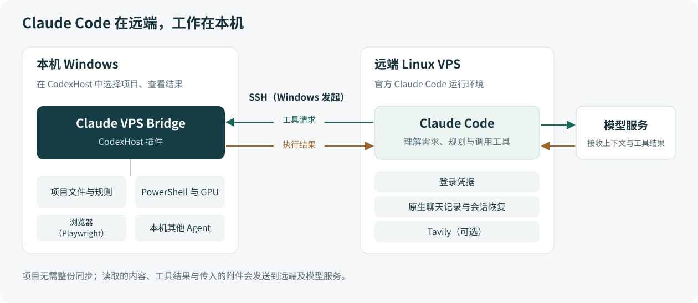

<p align="center">
  
</p>

<h1 align="center">Claude VPS Bridge</h1>

<p align="center">Claude Code 在 VPS 运行，项目与工具留在本机。</p>

<p align="center">
  <a href="https://github.com/vv-get-ti/claude-vps-bridge/releases/latest">下载</a> ·
  <a href="#快速开始">快速开始</a> ·
  <a href="docs/CONFIGURATION.md">配置</a> ·
  <a href="docs/FAQ.md">常见问题</a>
</p>

Claude VPS Bridge 是一个 [CodexHost](https://github.com/BytePioneer-AI/codex-host) 插件。Claude Code 在 VPS 上运行并保存登录凭据，你在 Windows 本机选择项目、发送消息，使用本机文件和开发工具完成任务。

## 功能

- **使用本机项目**：读取和修改文件，运行本机程序、测试与构建。切换项目时自动绑定对应目录，同名但路径不同的项目分别管理。
- **沿用项目配置**：加载项目规则、Skills 和支持的 `.claude` 配置。
- **继续原来的工作**：打开原聊天即可续接远端会话，也可以 fork 出新的聊天分支。需要并行改代码时可使用 Git worktree。
- **处理文件与附件**：将图片和 PDF 交给 Claude；视频等任务由 Claude 自行选择本机工具处理，生成的文件保存在本机。
- **查看账号额度**：在 CodexHost 中查看用量与重置时间。

支持 CodexHost 的 Agent 协作，也可按需接入本机 MCP 工具。

## 快速开始

### 1. 准备环境

| Windows 本机 | Linux x64 VPS |
|---|---|
| CodexHost 0.16.1、PowerShell 7、SSH 客户端、Python 3.11+、npm、ripgrep（`rg`） | Python 3、Bash、Node.js 24/npm、官方 Claude Code |

从 [CodexHost 官方发布页](https://github.com/BytePioneer-AI/codex-host/releases/tag/v0.16.1)安装宿主，在 VPS 上安装并登录 [Claude Code](https://code.claude.com/docs/en/setup)，再配置 Windows 到 VPS 的 SSH 连接。具体步骤见[安装指南](docs/SETUP.md)。

本机无需安装或登录 Claude Code，也无需开启 Windows SSH 服务。

### 2. 安装插件

从 [Releases](https://github.com/vv-get-ti/claude-vps-bridge/releases/latest) 下载 `claude-vps-bridge-<版本>.zip` 并解压，在包含 `install.ps1` 的目录打开 PowerShell 7，执行：

```powershell
python .\installer\configure.py --ssh-host my-linux-host --host-root 'D:\Apps\CodexHost'
pwsh -NoProfile -File .\install.ps1
```

将 `my-linux-host` 换成自己的 SSH 别名，`D:\Apps\CodexHost` 换成实际安装目录。`python` 需为 3.11 及以上版本，装有 Python 启动器时也可以用 `py -3`。

安装脚本准备两端插件与依赖，保留配置和会话，不修改 CodexHost 程序文件。

### 3. 开始使用

正常退出并重开 CodexHost，选择一个本机项目，再选择 **Claude VPS Bridge**。可以先让它确认工作目录：

```text
Report the current Windows project path. Do not modify any files.
```

返回的路径应与选中的本机项目一致。接下来就可以让 Claude 阅读代码、修改文件或运行测试。文件读写与命令执行的检查步骤见[试用](docs/SETUP.md#5-试用)。

### 4. 使用附件

将文件保存到项目后，可以直接告诉 Claude 文件路径，让它查看或处理。

直接拖入、粘贴图片还需要 CodexHost 的附件传递修复。这部分采用独立修复包，与插件分开安装；下载与使用步骤见[附件支持](docs/ATTACHMENTS.md)。

## 工作原理

本机插件通过 SSH 连接 VPS 上的 Claude Code。Claude 发出工具请求，Windows 在选中的项目中执行，再将结果送回原会话。



项目无需整份同步。源文件和生成结果保存在 Windows，Claude 的登录凭据与原生聊天记录保存在 VPS；Claude 读取的内容、工具结果和传入的附件会发送到 VPS 与模型服务。

更多细节见[架构说明](docs/ARCHITECTURE.md)。

## 配置与使用

| 想做什么 | 查看文档 |
|---|---|
| 配置 SSH、登录 Claude、完成安装 | [安装指南](docs/SETUP.md) |
| 使用项目规则、Skills、权限与可选 MCP | [配置说明](docs/CONFIGURATION.md) |
| 使用图片、PDF 和附件修复 | [附件支持](docs/ATTACHMENTS.md) |
| 升级、诊断、恢复或停用插件 | [维护说明](docs/OPERATIONS.md) |
| 了解已知问题和使用细节 | [常见问题](docs/FAQ.md) |

## 常见问题

**切换项目，需要重新配置 VPS 吗？**

不需要。插件根据当前本机项目建立远端映射，首次使用时自动准备对应目录。项目文件仍在本机。

**会读取本机的 `CLAUDE.md` 和 `.claude` 吗？**

会加载适用的项目规则、Skills 和支持的配置。配置项的兼容范围见[配置说明](docs/CONFIGURATION.md)，本机的登录凭据和模型接口设置不会导入 VPS。

**重开后还能继续之前的聊天吗？**

打开原聊天即可恢复对应的远端会话。新建聊天会建立独立会话；fork 创建聊天分支，但仍共用项目文件。

**更新 CodexHost 后，附件修复怎么办？**

附件修复与宿主版本对应，升级前查看[附件支持](docs/ATTACHMENTS.md)。插件更新和宿主附件修复分别维护。

## 项目结构

```text
plugin/        Windows 本机插件，安装到 CodexHost 插件目录
remote/        VPS 端桥接，安装到远端用户目录
installer/     配置、安装、升级与停用脚本
compatibility/ CodexHost 附件修复
docs/          安装、配置、架构与维护文档
examples/      配置示例
scripts/       源码与公开内容检查
```

## 参与贡献

欢迎反馈问题、改进文档或提交代码。提交改动前请阅读[贡献指南](CONTRIBUTING.md)，添加工具可参考[扩展接口](docs/EXTENDING.md)。安全问题见[安全说明](SECURITY.md)。

## 许可证与致谢

采用 [LGPL-3.0-only](LICENSE)。LGPL 以 GPL 为基础，按其要求随附 [GPL-3.0 全文](LICENSE-GPL-3.0)。第三方组件与图形的授权见[第三方声明](THIRD_PARTY_NOTICES.md)。

感谢 [CodexHost](https://github.com/BytePioneer-AI/codex-host) 提供插件接口与 Claude 适配器。Clawd 图形来自 [LobeHub Icons](https://github.com/lobehub/lobe-icons)，来源与许可见第三方声明。
